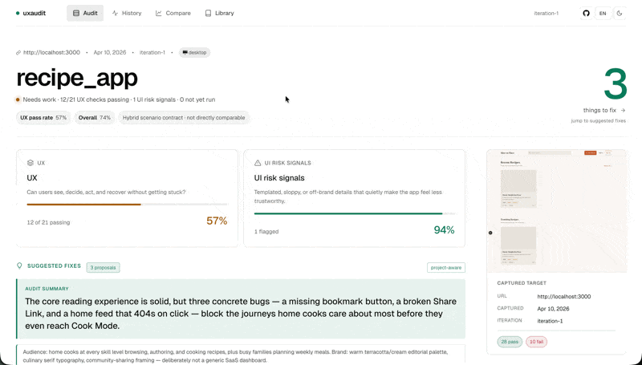
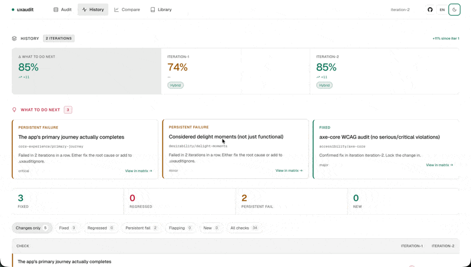
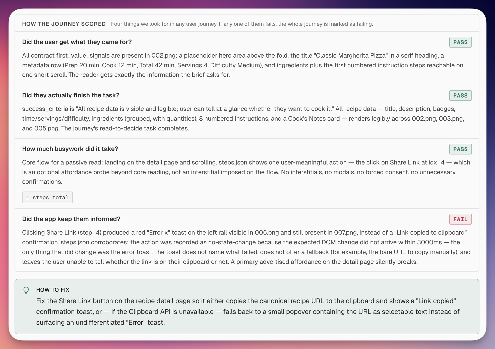
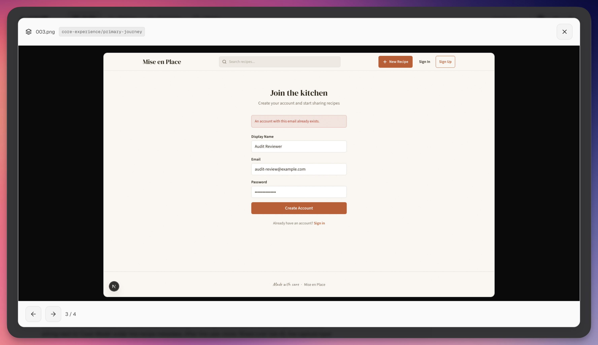
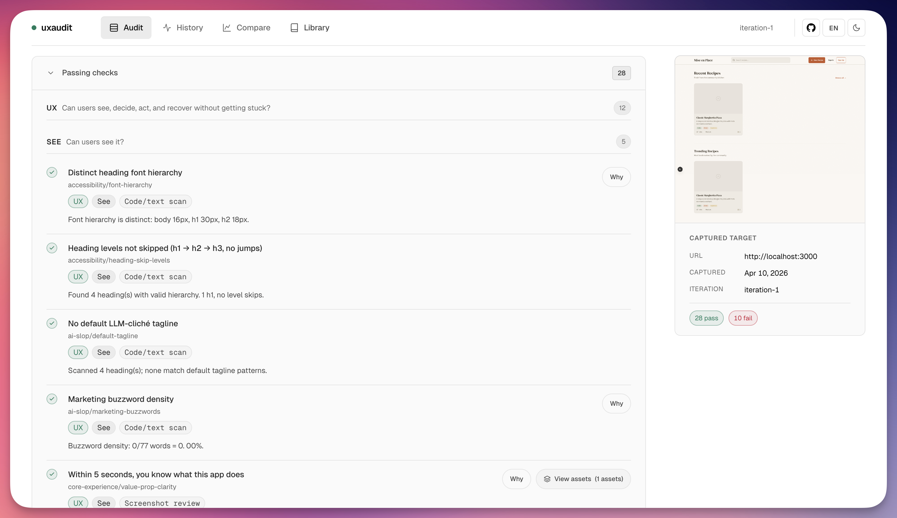
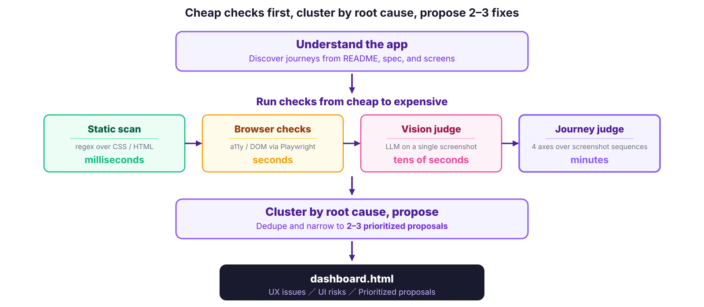

# uxaudit

[English](./README.md) | [日本語](./README_ja.md)

> **A [Claude Code](https://code.claude.com) plugin for UX regression testing — evaluates whether people can understand, decide, act, and recover across real user journeys.**

> [!WARNING]
> **Status: Experimental.** UX Audit is still evolving, and interfaces, outputs, checks, and workflows may change without notice.

1. **Reads your project** — code, routes, docs, tests — and auto-generates journey scenarios specific to your product (typically 5–8+)
2. **Walks each journey** on the live app — can someone sign up, reach first value, recover when things go wrong?
3. **Runs ~40 additional checks** across AI-slop, accessibility, usability, core experience, and desirability
4. **Returns a ranked fix plan** with screenshot evidence you can hand straight back to your coding agent

Every check cites a published source (WCAG 2.2, NN/g, Nielsen, Krug, Baymard, ISO 9241) — no vibes. Built for teams shipping fast with Claude Code and coding agents.

**Actual run on a sample recipe app** — journey scenarios were auto-generated, each walked on the live app:

<p align="center">
  
  
</p>

**Try it**

```bash
# Inside Claude Code — URL is auto-detected from your project config
/uxaudit:uxaudit my-app
```

Quick catalog-only check (skip journey evaluation):

```bash
/uxaudit:uxaudit my-app --skip core-experience
```

**Host support**

- **Claude Code** — first-class. Installed as a plugin, invoked as `/uxaudit:uxaudit`.
- **Codex and other coding-agent hosts** — not yet supported. The `skills/uxaudit/` bundle is being designed to be portable, and broader host support is on the roadmap.

**Maturity:** experimental. Catalog checks, capture pipeline, dashboard, and history/compare views are used today; richer `decide` / `recover` evaluation and tighter host portability are still being built out. A full audit (catalog + journey evaluation) typically takes **30–60 minutes** in Claude Code; Max plan is recommended for regular use.

---

## What it catches

uxaudit runs ~40 checks grouped into five categories. Every check is backed by a published source — no opinion-only findings.

| Category | What it checks | Example findings |
|---|---|---|
| **ai-slop** | Fingerprints of AI-generated UI | purple gradients, shadcn defaults everywhere, "coming soon" stubs, emoji-as-icon, generic hero copy |
| **accessibility** | WCAG 2.2 AA floor | contrast, tap targets, focus rings, keyboard reach, axe-core violations |
| **usability** | Nielsen heuristics & journey continuity | dead-end flows, missing empty states, weak error recovery, inconsistent feedback |
| **core experience** | Primary journey completion | can a new user actually sign up, create the first thing, and share it? |
| **desirability** | Visual craft, microcopy, first impression | typography drift, generic voice, weak aesthetic impression |

Full citation list: [`skills/uxaudit/references/knowledge/sources.md`](./skills/uxaudit/references/knowledge/sources.md).

## How it fits with what you already run

|  | Playwright / Cypress | axe / Lighthouse | **uxaudit** |
|---|---|---|---|
| Does the user flow execute? | ✅ | — | — |
| WCAG AA violations? | — | ✅ | ✅ (floor) |
| Core Web Vitals / perf? | — | ✅ | — |
| Can a new user reach first value without friction? | — | — | ✅ |
| Dead-end / recovery / decision-cost checks? | — | — | ✅ |
| AI-slop & design-system drift detection? | — | — | ✅ |
| Ranked fix plan with evidence & history? | — | — | ✅ |

E2E tells you the flow *runs*. uxaudit tells you the flow *makes sense while running*. It is meant to sit between your test suite and manual review — most teams run it between "E2E passes" and "merge".

See [Overview and positioning](./docs/overview.md) for the longer explanation.

## How to read a run

The dashboard is designed to be actionable:

1. Read the run through reader-facing buckets (`UX issues` / `UI risk signals`)
2. Inspect the evidence behind each finding
3. Decide which proposals to push into the next implementation loop

<p align="center">
  
  
</p>

The report also makes it easy to inspect the difference between failures and healthy surfaces, so reviewers do not mistake "we found issues" for "everything is broken."



## Target surface

- **Supported now:** web apps, browser-like runtimes, and Electron
- **Also includes:** browser-based product surfaces and task-oriented websites
- **Out of scope:** pure native macOS/iOS/Android apps and CLIs

See [Overview and positioning](./docs/overview.md) for the longer explanation of where uxaudit sits relative to E2E, accessibility checks, and manual QA.

<p align="center">
  
</p>

## Requirements

- **Claude Code** CLI with plugin marketplace support (Max plan recommended)
- **Node.js 24.22.1+ (24.x)** and **Python 3.10+**
- **~300 MB disk** for Playwright Chromium on first install

Journey checks use Playwright first and escalate to `computer-use` only when the flow temporarily crosses outside Playwright's control (file pickers, OS dialogs, external auth). Verdicts are based on visible step-by-step state changes, not DOM inspection.

## Installation

Install uxaudit from this repository's Claude Code marketplace:

```bash
# 1. Add the marketplace from GitHub
claude plugin marketplace add gotalab/uxaudit

# 2. Install the plugin from that marketplace
claude plugin install uxaudit@gotalab-uxaudit

# 3. Start Claude Code normally
claude
```

For a shared repository setup:

```bash
claude plugin marketplace add gotalab/uxaudit
claude plugin install uxaudit@gotalab-uxaudit --scope project
```

From inside an active Claude Code session:

```text
/plugin marketplace add gotalab/uxaudit
/plugin install uxaudit@gotalab-uxaudit
/reload-plugins
```

On first use, the plugin installs Playwright Chromium if needed. Verify it loaded with `/plugin`. The skill is invoked as `/uxaudit:uxaudit`.

## Quick start (once the plugin is installed)

```bash
# Run the audit — URL is auto-detected, dev server is started if needed
/uxaudit:uxaudit my-app

# Or specify the URL explicitly
/uxaudit:uxaudit my-app --url http://localhost:3000
```

Other modes:

```bash
/uxaudit:uxaudit my-app --lang ja                           # Japanese output
/uxaudit:uxaudit my-app --viewport mobile                   # responsive (mobile/tablet/desktop-lg/etc.)
/uxaudit:uxaudit my-app --viewports mobile,tablet,desktop   # multi-viewport in one run
/uxaudit:uxaudit my-app --electron-app ./apps/desktop/main.js
/uxaudit:uxaudit my-app --only ai-slop,usability            # category filter
/uxaudit:uxaudit my-app --skip core-experience              # skip journeys
```

Full viewport presets and argument reference: [`skills/uxaudit/SKILL.md`](./skills/uxaudit/SKILL.md).

After multiple audit iterations you can view the timeline, compare two workspaces, or see the cross-project library:

```bash
# From the skill bundle
python $UXAUDIT_DIR/scripts/generate_dashboard.py <workspace> --timeline
python $UXAUDIT_DIR/scripts/generate_dashboard.py <ws-a> <ws-b> --compare
python $UXAUDIT_DIR/scripts/generate_dashboard.py --library
```

## Learn more

- [Overview and positioning](./docs/overview.md)
- [Maturity, workflow, and roadmap](./docs/overview.md#current-maturity)
- [Skill runtime reference](./skills/uxaudit/SKILL.md)
- [Check sources and citations](./skills/uxaudit/references/knowledge/sources.md)

## Issues & feedback

Bug reports and concrete UX-pattern observations (especially "I see this in ≥3 real projects") are welcome via GitHub issues.

## License

Apache License 2.0 — see [LICENSE](./LICENSE) and [NOTICE](./NOTICE).
