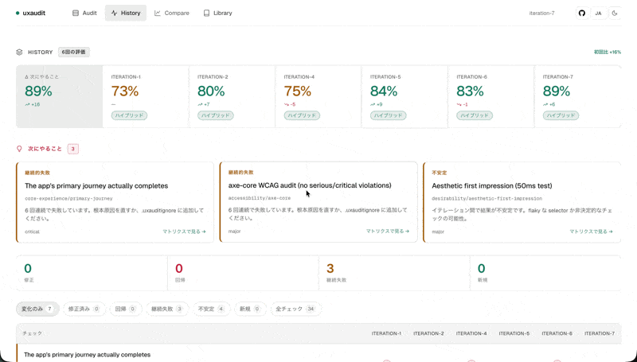
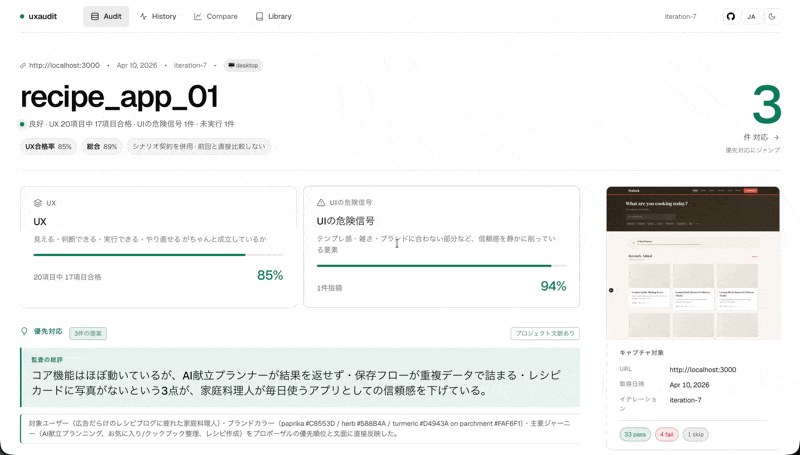
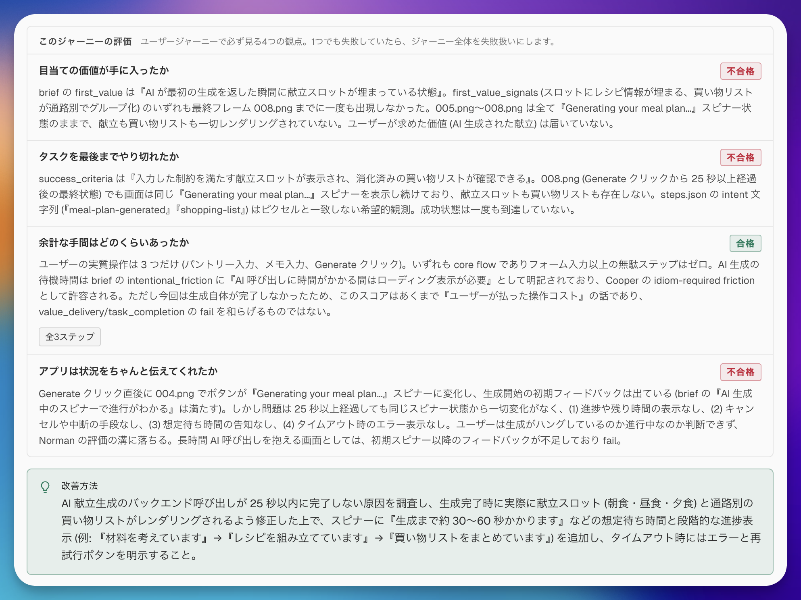
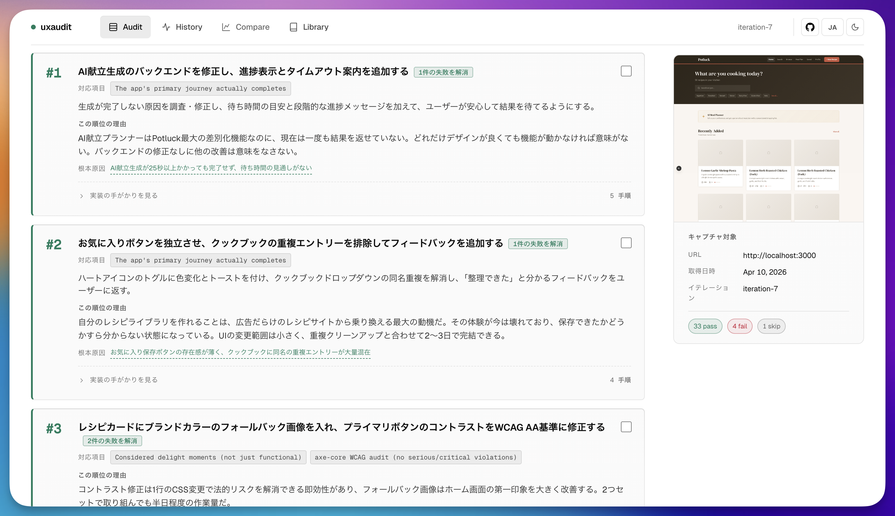
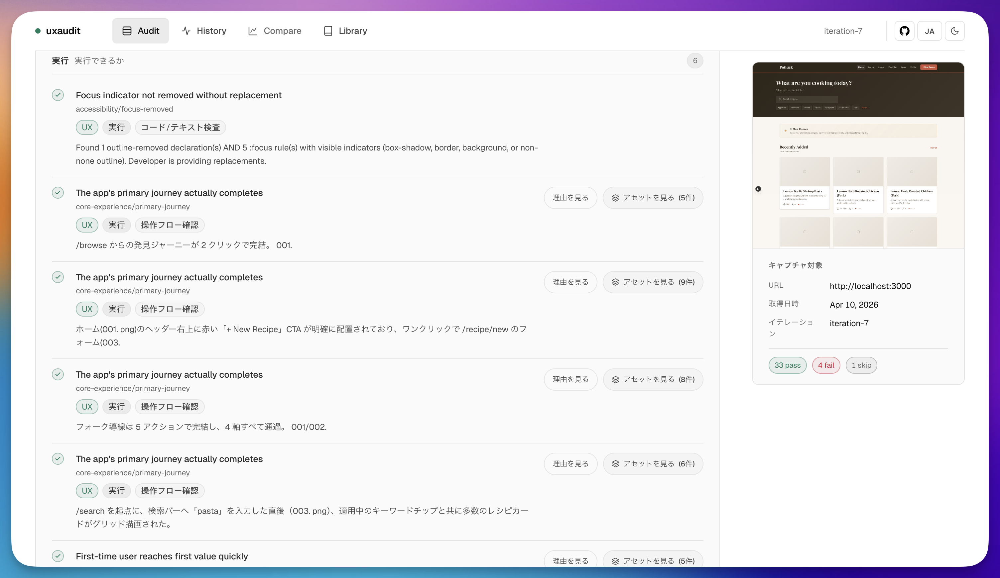
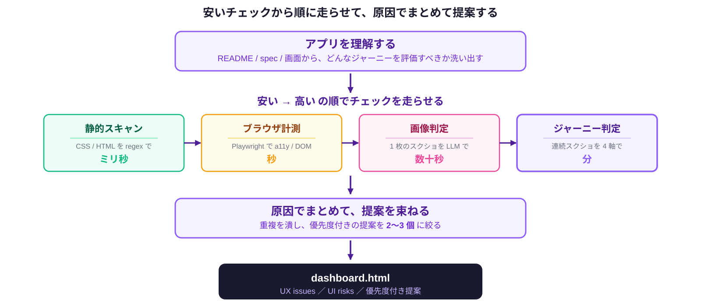

# uxaudit

[English](./README.md) | [日本語](./README_ja.md)

> **[Claude Code](https://code.claude.com) 向けの UX regression testing plugin。人が理解し、判断し、行動し、回復できるかを、実際の user journey を通して評価する。**

> [!WARNING]
> **Status: Experimental.** UX Audit はまだ発展途中で、interface、output、check、workflow は予告なく変わる可能性があります。

1. **プロジェクトを読む** — コード、ルート定義、ドキュメント、テストから、そのプロダクト固有の journey シナリオを自動生成（通常 5〜8 以上）
2. **各 journey を実際に歩く** — sign up できるか、first value に到達できるか、問題時に回復できるか
3. **約 40 の追加 check を実行** — AI-slop / accessibility / usability / core experience / desirability
4. **ranked fix plan を返す** — screenshot evidence 付きで、そのまま次の coding loop に渡せる

すべての check は出典付き（WCAG 2.2、NN/g、Nielsen、Krug、Baymard、ISO 9241）— 主観ベースの findings は含まない。Claude Code や coding agent で高速に開発しているチーム向け。

**実際の run（サンプルのレシピアプリ）** — journey シナリオは自動生成され、各 journey を実際に歩いた結果:

<p align="center">
  
  
</p>

**試す**

```bash
# Claude Code の中から — URL はプロジェクト設定から自動検出される
/uxaudit:uxaudit my-app --lang ja
```

catalog check のみのクイック実行（journey 評価を skip）:

```bash
/uxaudit:uxaudit my-app --lang ja --skip core-experience
```

**対応ホスト**

- **Claude Code** — first-class。plugin として install し、`/uxaudit:uxaudit` で呼び出す。
- **Codex などその他の coding-agent host** — 現在未対応。`skills/uxaudit/` bundle は portable に設計されており、他ホスト対応は roadmap にある。

**成熟度:** experimental。catalog check / capture pipeline / dashboard / history / compare view は実運用されているが、より深い `decide` / `recover` 評価や host portability はまだ整備中。full audit（catalog + journey 評価）は Claude Code で **30–60 分** が目安。継続利用には Max plan 推奨。

---

## 検出できること

uxaudit は 5 カテゴリにわたる約 40 の check を走らせる。すべての check は出典付きで、主観だけの findings は一切含まない。

| カテゴリ | 対象 | 代表的な findings |
|---|---|---|
| **ai-slop** | AI 生成 UI の指紋 | 紫グラデ、shadcn デフォルトのまま、"coming soon" の放置、emoji をアイコン代わり、汎用的な hero コピー |
| **accessibility** | WCAG 2.2 AA の床面 | コントラスト、tap target、focus ring、keyboard reach、axe-core 違反 |
| **usability** | Nielsen heuristics と journey の連続性 | dead-end、empty state の欠如、弱い error recovery、一貫性のない feedback |
| **core experience** | 主要 journey の完遂 | 新規ユーザーが実際に sign up し、最初の 1 つを作り、共有できるか |
| **desirability** | visual craft、microcopy、第一印象 | typography の drift、汎用的な voice、弱い aesthetic |

全出典リスト: [`skills/uxaudit/references/knowledge/sources.md`](./skills/uxaudit/references/knowledge/sources.md)

## 既存の test 群との棲み分け

|  | Playwright / Cypress | axe / Lighthouse | **uxaudit** |
|---|---|---|---|
| user flow がちゃんと実行されるか | ✅ | — | — |
| WCAG AA 違反の検出 | — | ✅ | ✅ (床面) |
| Core Web Vitals / perf | — | ✅ | — |
| 新規ユーザーが first value に摩擦なく到達できるか | — | — | ✅ |
| dead-end / recovery / decision cost の check | — | — | ✅ |
| AI-slop / design system drift の検出 | — | — | ✅ |
| evidence と history 付きの ranked fix plan | — | — | ✅ |

E2E は flow が *動くか* を教えてくれる。uxaudit は flow が *動いている最中に意味を成しているか* を教えてくれる。test suite と manual review の間、すなわち「E2E が通った」と「merge」の間に差し込むのが典型的な使い方。

詳しい位置付けは [Overview](./docs/overview_ja.md) を参照。

## dashboard の読み方

dashboard は action につながるように設計している:

1. reader-facing な buckets（`UX issues` / `UI risk signals`）で run 全体を読む
2. 各 finding の evidence を確認する
3. どの proposal を次の implementation loop に流すかを決める

<p align="center">
  
  
</p>

fail だけでなく pass も見えるので、「問題が見つかった」ことと「全部ダメ」を混同しにくくしている。



## 対象範囲

- **現在サポート:** web app、browser-like runtime、Electron
- **ここでいう app に含むもの:** browser-based な product surface、task-oriented な website
- **対象外:** pure native の macOS / iOS / Android app、CLI

E2E、accessibility check、manual QA との位置づけを含む長い説明は [overview](./docs/overview_ja.md) を参照。

<p align="center">
  
</p>

## Requirements

- **Claude Code** CLI と plugin marketplace support（Max plan 推奨）
- **Node.js 20+** と **Python 3.10+**
- **Playwright Chromium 用に約 300 MB の空き容量**

journey check は Playwright first で動き、file picker / OS dialog / 外部 auth のように一時的に Playwright の外へ出るときだけ `computer-use` にエスカレーションする。判定は DOM inspection ではなく、visible な step-by-step state change に基づく。

## Installation

このリポジトリが持つ Claude Code marketplace から install する。

```bash
# 1. GitHub 上の marketplace を追加
claude plugin marketplace add gotalab/uxaudit

# 2. その marketplace から plugin を install
claude plugin install uxaudit@gotalab-uxaudit

# 3. Claude Code を通常起動
claude
```

リポジトリ単位で共有したい場合:

```bash
claude plugin marketplace add gotalab/uxaudit
claude plugin install uxaudit@gotalab-uxaudit --scope project
```

進行中の Claude Code session 内から追加することもできる。

```text
/plugin marketplace add gotalab/uxaudit
/plugin install uxaudit@gotalab-uxaudit
/reload-plugins
```

初回利用時に Playwright Chromium が自動インストールされる。`/plugin` で読み込みを確認でき、skill の呼び出しは `/uxaudit:uxaudit`。

## Quick start

```bash
# audit を実行 — URL は自動検出、dev server も必要なら自動起動
/uxaudit:uxaudit my-app --lang ja

# URL を明示的に指定する場合
/uxaudit:uxaudit my-app --url http://localhost:3000 --lang ja
```

他のモード:

```bash
/uxaudit:uxaudit my-app --viewport mobile                   # responsive (mobile/tablet/desktop-lg 等)
/uxaudit:uxaudit my-app --viewports mobile,tablet,desktop   # 1 回の run で複数 viewport
/uxaudit:uxaudit my-app --electron-app ./apps/desktop/main.js
/uxaudit:uxaudit my-app --only ai-slop,usability            # カテゴリ filter
/uxaudit:uxaudit my-app --skip core-experience              # journey を skip
```

viewport preset と引数の詳細: [`skills/uxaudit/SKILL.md`](./skills/uxaudit/SKILL.md)

複数 iteration を回した後は、timeline、workspace 比較、cross-project library を見られる。

```bash
python $UXAUDIT_DIR/scripts/generate_dashboard.py <workspace> --timeline
python $UXAUDIT_DIR/scripts/generate_dashboard.py <ws-a> <ws-b> --compare
python $UXAUDIT_DIR/scripts/generate_dashboard.py --library
```

## Learn more

- [Overview](./docs/overview_ja.md)
- [Current maturity / workflow / roadmap](./docs/overview_ja.md#current-maturity)
- [Skill runtime reference](./skills/uxaudit/SKILL.md)
- [Citation sources](./skills/uxaudit/references/knowledge/sources.md)

## Issues & feedback

不具合報告や、実プロジェクトで繰り返し観測された UX pattern の報告を歓迎。

## License

Apache License 2.0 — [LICENSE](./LICENSE) / [NOTICE](./NOTICE) を参照。
