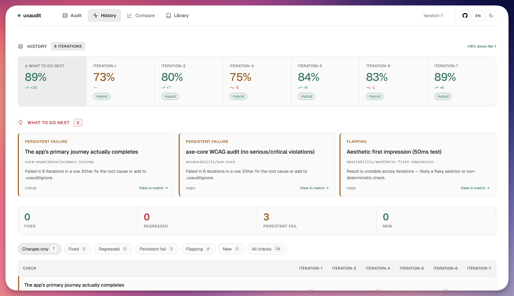
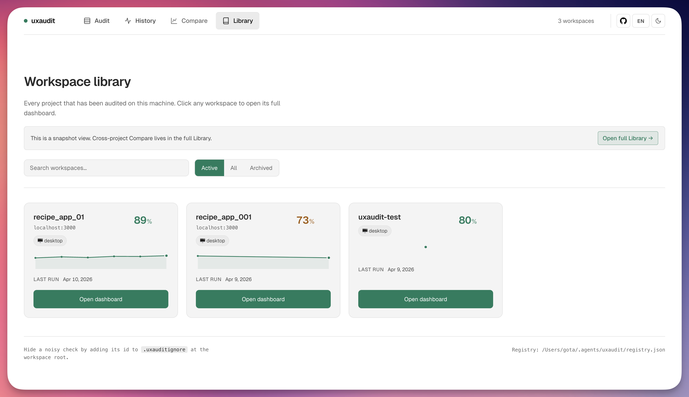

# Overview

This document carries the longer-form explanation of what uxaudit is, where it sits, and what it is trying to become.

## What E2E tells you vs what uxaudit tells you

| Layer | Question | Tool |
|---|---|---|
| Unit | "Does the component or function behave as specified?" | Jest / Vitest / pytest |
| Property-based | "Do the invariants still hold across many kinds of input?" | fast-check / Hypothesis |
| Integration | "Do the parts still work when combined?" | Jest / Vitest / pytest |
| E2E | "Does the user flow execute correctly?" | Playwright / Cypress |
| Visual / A11y checks | "Are there major UI breakages or accessibility failures?" | Percy / Chromatic / axe / Playwright |
| **⬆ Everything above can make CI green ⬆** | | |
| **⬇ Everything below decides whether it is actually usable ⬇** | | |
| **uxaudit (this)** | **"Can a human or browser-use / computer-use agent understand the product, choose the next action, complete the core job, and recover when something goes wrong?"** | **uxaudit** |
| Manual QA / dogfooding | "Is anything subjectively off?" | humans |

Accessibility and UI quality are not a single late-stage layer. They cut across the stack:

- **In CI** they show up as semantic checks, keyboard coverage, visual regression, responsive breakage, and obvious interaction failures.
- **In uxaudit** they show up as "can someone understand this, choose what to do next, and recover when the interface pushes back?"

Passing E2E is necessary, but it is not the same as being ship-ready. An app can be CI-green while still being:

- **unusable** (broken primary journey, missing empty states, unreadable contrast)
- **AI-slop-shaped** (generic purple gradients, "your AI copilot" taglines, shadcn defaults everywhere, emoji as icons, "coming soon" placeholders)
- **inaccessible** (WCAG AA violations — keyboard-only, screen-reader, tap targets)
- **incoherent** (design system applied inconsistently, typography drift, journey hand-off dead ends)

As browser-use agents and computer-use agents become normal parts of product use, QA, and support, the same UX failures hurt both humans and agents: unclear value props, weak hierarchy, dead-end flows, unnecessary steps, and missing recovery cues.

## Target surface

uxaudit is not limited to websites, but it is also not "all apps."

Here, `apps` includes web apps, browser-based product surfaces, and task-oriented websites.

- **Supported now:** web apps and browser-like runtimes
- **Also supported:** Electron, when the runtime can be launched and captured in-session
- **Reachable through escalation:** flows that temporarily cross OS surfaces through `computer-use`
- **Out of scope:** pure native macOS/iOS/Android apps and CLIs

The real boundary is not "web" versus "desktop." The boundary is whether the interface is a rendered, agent-operable surface that uxaudit can capture and evaluate. `computer-use` expands the reachable surface, but it does not yet make native apps a first-class audit target.

## Product claim

uxaudit is the missing quality layer between correctness checks and manual design review.

- **E2E** tells you whether the flow executes.
- **Visual / A11y checks** tell you whether major UI and accessibility regressions slipped through.
- **uxaudit** tells you whether the experience is understandable, usable, and intentional.
- **humans** still decide what matters most — but they start from a concrete report instead of vague discomfort.

The job is not "AI rates your UI." The job is **UX regression testing for apps**:

- run against a real app
- inspect visible artifacts and live journeys
- evaluate whether core jobs reach first value with low friction
- compare iterations over time
- produce a fixable, reviewable feedback loop instead of a one-off opinion

## Positioning

uxaudit should be read as **UX regression testing for apps**, not a website grader and not a prettier lint rule.

- **Not just UI polish** — it cares about whether people can understand the product, choose the next action, reach first value, and recover when the app pushes back
- **Not just correctness** — E2E already covers "did the flow execute"; uxaudit covers "did the experience make sense while doing it"
- **Not generic product strategy** — it does not decide whether the company built the right product; it evaluates whether the current product is legible and operable for the jobs it claims to serve

The best current wedge is:

- **UX regression testing for apps**
- **for teams shipping fast with Playwright / coding agents / vibe-coded UI**
- **most often after E2E passes, before merge or release**

## What matters most

The most important part of uxaudit is not the checklist surface. It is the combination of:

- **Journey evaluation** — can the product's important jobs actually be completed without dead ends, hesitation, or avoidable friction?
- **Project-shaped evaluation** — what counts as first value, what users must understand, which decisions should be obvious, and where recovery matters for this specific product?
- **A continuous feedback loop** — can teams compare iterations, compare projects, and keep improving UX quality over time instead of running one-off audits?

Accessibility, AI-slop detection, and visual-craft checks matter. They make the floor stronger and make the report credible. But they are still supporting checks. By themselves they would still be "better lint."

What makes uxaudit different is the move from **generic checks** to **project-aware journey auditing** with history, comparison, and ranked proposals.

Another way to say it:

- **UI risk checks** keep the floor from collapsing
- **UX regression checks** decide whether the product's real jobs actually work

## What it does (and what it doesn't)

### uxaudit's responsibility

- **Capture** the running interface (DOM, CSS, screenshots) at one or more viewports
- **Run ~40 checks** across 5 categories (AI slop, accessibility, usability, core experience, desirability)
- **Judge** the catalog + journey checks (a mix of deterministic scripts, runtime browser checks, vision-based judgment, and pixel-only multi-step journeys)
- **Reconcile** catalog fails that the project's own design system justifies
- **Propose** a ranked fix plan grouped by root cause
- **Render** a self-contained HTML dashboard with evidence, citations, history, compare views, and the proposal embedded

### NOT uxaudit's responsibility

- **Not a fix loop runner** — uxaudit produces findings + proposals; the orchestrator or the human applies fixes, then re-runs uxaudit to verify
- **Not an E2E test replacement** — it assumes your app works; it tells you whether it works for humans and increasingly for browser-use / computer-use agents
- **Not yet a native-app audit framework** — `computer-use` helps at runtime boundaries, but the full audit model is still web/electron-first
- **Not a performance benchmark** — use Lighthouse for Core Web Vitals
- **Not a correctness checker** — that's your test suite's job
- **Not a market-fit oracle** — the spec might be the wrong spec; that's a human question

## Current maturity

uxaudit already has a real product shape, but it should currently be read as an **alpha**.

- **Strong today** — deterministic catalog checks, capture pipeline, evidence model, dashboard, history/compare/library views, project-context schema, ranked proposal model
- **Emerging now** — project-shaped briefs, first-value framing, pixel-only journey judging, cross-check synthesis
- **Still becoming first-class** — richer `decide` and `recover` evaluation, broader scenario coverage, tighter standalone orchestration outside Claude Code

That matters because the ambition is larger than "UI lint." The target is UX regression testing for apps, and some of the most important parts of that surface are still being operationalized.

## Why now

- **Correctness testing is not the whole story.** Teams can test flows well and still ship UX regressions, weak first-use experiences, and broken journeys.
- **Agents are entering the loop.** More software is being operated, tested, and supported through coding agents, browser-use agents, and computer-use agents, so interfaces need to be legible to both humans and agents.
- **The feedback loop can be continuous.** uxaudit stores iterations, compares runs, and fits naturally into the same implementation environments where code already changes.

## Continuous workflow

This is not meant to be a one-shot report. History and library views make repeated runs useful over time, especially when the next step is "pick a fix, implement it, rerun, compare."

  
  

## Roadmap

The roadmap should follow the UX-regression-for-apps thesis, not expand sideways into generic site auditing.

### 1. Make current UX regression coverage harder to dispute

- solidify the end-to-end Judge dispatch flow so L3/L4 are routine, not special
- ship sample audited apps and sample outputs that show first-value / primary-journey findings, not just slop detection
- make PR / CI usage straightforward for pre-ship UX regression runs

### 2. Promote `decide` and `recover` to first-class evaluation targets

- generate explicit briefs for decision cost, defaults, and choice overload
- add first-class recovery checks for undo, backtracking, retries, and state preservation
- score job friction in a way that is stable across iterations

### 3. Improve project-shaped discovery

- strengthen Scout coverage for multi-job apps, chained journeys, and role-specific flows
- support stronger domain expectations in regulated or high-trust apps
- make "coverage weakness" visible when too few journeys were discovered

### 4. Become the UX regression layer teams can actually standardize on

- CI-ready workflows and example integrations
- contribution docs and check-authoring examples for external contributors
- clearer host portability story beyond Claude Code

## Check categories

These categories are the audit surface, not the whole point. Every check cites a published source (WCAG 2.2, NN/g, Nielsen, Krug, Baymard, ISO 9241, Anthropic `frontend-design`). No vibes.

| Category | What it checks | Example |
|---|---|---|
| `ai-slop/` | Fingerprints of AI-generated UI | purple gradients, shadcn defaults, "coming soon" text, emoji-as-icon, generic hero copy |
| `accessibility/` | WCAG 2.2 AA floor | axe-core violations, contrast, tap targets, focus rings, keyboard reach |
| `usability/` | Nielsen heuristics, journey continuity | error recovery, empty states, consistency, feedback, excise detection |
| `core-experience/` | Primary journey completion | can a user actually sign up, create the first thing, and share it? |
| `desirability/` | Visual craft, microcopy, first impressions | typography distinctiveness, copy voice, delight moments, aesthetic impression |

See [`../skills/uxaudit/references/knowledge/sources.md`](../skills/uxaudit/references/knowledge/sources.md) for the full citation list.
